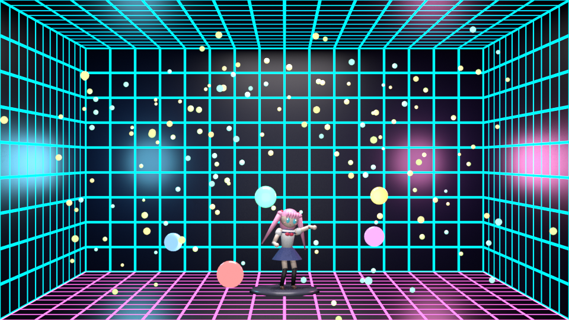
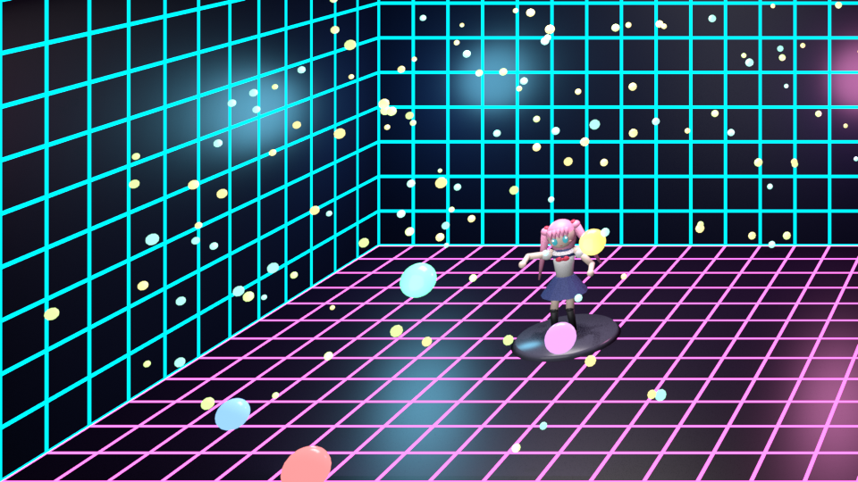
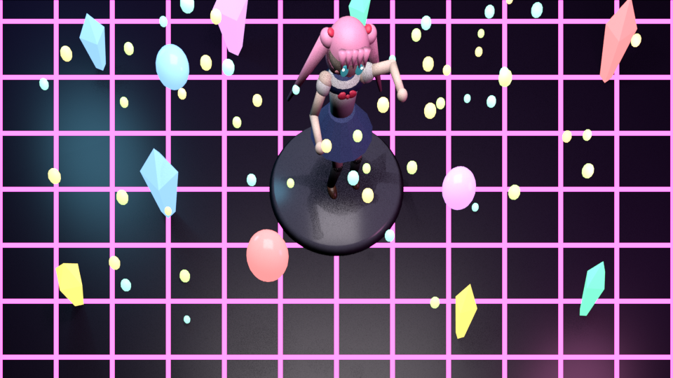
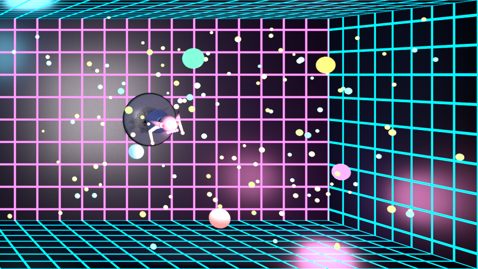
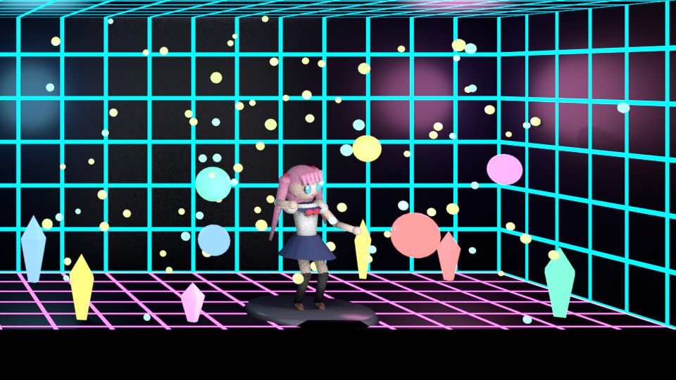

# headtracking-server

Монитор как окно в 3D-сцену. Обычная вебкамера следит за положением головы, а аддон для
Blender перерисовывает вьюпорт так, будто сцена стоит за стеклом экрана (или на нём): сдвигаешь
голову — заглядываешь за край объекта. Это head-coupled perspective, как в демо Johnny Lee
с Wii-пультом или в [Portalgraph](https://portalgraphvr.gitbook.io/portalgraph-document-en).

| Комната за стеклом | Тот же кадр из угла | Экран лежит на столе |
|---|---|---|
|  |  |  |

> Картинки — рендеры демо-сцен для разных положений глаза. Вживую эффект виден только
> в движении и лучше всего одним глазом: двумя мозг замечает, что экран плоский.

## Содержание

- [Что внутри](#что-внутри)
- [Быстрый старт](#быстрый-старт)
- [Как это работает](#как-это-работает)
- [Трекер](#трекер)
  - [Установка и запуск](#установка-и-запуск)
  - [Окно трекера](#окно-трекера)
  - [Калибровка](#калибровка)
- [Аддон для Blender](#аддон-для-blender)
  - [Установка](#установка)
  - [Режим «Окно»](#режим-окно)
  - [Режим «Камера на голове»](#режим-камера-на-голове)
  - [Все настройки панели](#все-настройки-панели)
- [Демо-сцены](#демо-сцены)
- [Своя сцена с порталом](#своя-сцена-с-порталом)
- [Как получить эффект поубедительнее](#как-получить-эффект-поубедительнее)
- [Протокол](#протокол)
- [Сборка](#сборка)
- [Задержка и производительность](#задержка-и-производительность)
- [Структура репозитория](#структура-репозитория)
- [Ограничения](#ограничения)
- [Лицензия](#лицензия)

## Что внутри

- **Трекер** (`main.py`) — десктопное приложение на Python. Берёт кадры с вебки, находит лицо
  (MediaPipe), считает позу головы и положение глаз в сантиметрах и раздаёт их по UDP. Окно
  с превью, выбором камеры, ручной выдержкой и калибровкой. Собирается в exe через PyInstaller.
- **Аддон Blender** (`blender_addon/head_tracking`) — подключается к трекеру и управляет
  вьюпортом. Режим «Окно» — off-axis проекция под положение глаза, режим «Камера на голове» —
  вид повторяет движения головы. Ничего не портит в файле: после «Стоп» всё как было.
- **Демо-сцены** (`blender_addon/demo`) — два .blend-файла по две сцены: комната за стеклом,
  колодец под экраном, сцена на лежащем экране «как у Portalgraph» и неглубокая сцена для
  обычного монитора. Плюс скрипты, которые их собирают.

## Быстрый старт

1. Запустить трекер ([установка](#установка-и-запуск)), выбрать камеру, нажать **Старт** у сервера.
2. Один раз сделать [калибровку](#калибровка): межзрачковое расстояние, расстояние до камеры,
   задержку.
3. Установить аддон в Blender 4.2+ ([установка](#установка)).
4. Открыть `blender_addon/demo/portal_demo.blend`, развернуть Blender на весь экран, вьюпорт —
   на всё окно (Ctrl+Alt+Space).
5. N-панель → вкладка **View** → **Head Tracking**: указать размеры экрана в см, нажать **Старт**.
   Space — запустить анимацию.

## Как это работает

```
 вебка 30 fps ──► поток захвата ──► MediaPipe Face Landmarker ──► поза головы (4×4, см)
                  (всегда самый       478 точек лица +              │
                   свежий кадр)       матрица позы                  ▼
                                                     центры глазных яблок по канонической
                                                     модели лица + калибровка (межзрачковое,
                                                     глубина, задержка камеры)
                                                                    │  UDP, JSON на кадр
                                                                    ▼
 вьюпорт Blender ◄── off-axis камера ◄── предсказание ◄── фильтр Калмана (положение,
   (окно в сцену)    (shift + фокусное)   на задержку      скорость, ускорение)
```

1. **Захват.** Кадры читаются в отдельном потоке, обработка всегда берёт последний. Иначе
   очередь драйвера (4 кадра) копится и добавляет до ~130 мс задержки.
2. **Распознавание.** [MediaPipe Face Landmarker](https://ai.google.dev/edge/mediapipe/solutions/vision/face_landmarker)
   (Tasks API, режим VIDEO) даёт точки лица, включая радужки, и матрицу позы головы —
   преобразование канонической модели лица в координаты камеры, в сантиметрах.
3. **Глаза.** Точка обзора — середина между центрами глазных яблок. Они берутся из канонической
   модели лица и переносятся позой головы, поэтому привязаны к черепу и не дёргаются, когда
   переводишь взгляд (в отличие от радужки).
4. **Калибровка.** MediaPipe считает расстояние для «средней головы» и камеры с вертикальным углом
   обзора 63°. Межзрачковое расстояние масштабирует всю позу, масштаб глубины — только ось z.
5. **Доставка.** UDP, одна датаграмма JSON на кадр каждому подписавшемуся клиенту.
6. **Blender.** Аддон опрашивает сокет 120 раз в секунду, фильтрует положение глаза фильтром
   Калмана (модель постоянного ускорения) и экстраполирует его на полную задержку: камера +
   обработка + время с прихода данных.
7. **Окно.** Временная камера стоит в точке глаза и смотрит перпендикулярно экрану, а фокусное
   и сдвиг объектива подобраны так, что рамка кадра совпадает с рамкой на мониторе. Точки
   в плоскости экрана при движении головы стоят на месте, далёкие едут вместе с головой — как
   за настоящим стеклом.

## Трекер

### Установка и запуск

Нужен **Python 3.12**: под него проверено, а под 3.14 у mediapipe нет колёс. На Linux системному
Python обычно не хватает `libpython3.12.so` для PyInstaller, поэтому проще взять Python
от [uv](https://docs.astral.sh/uv/).

Linux:

```bash
uv venv --managed-python --python 3.12 .venv
uv pip install --python .venv/bin/python -r requirements.txt -r requirements-build.txt
.venv/bin/python main.py
```

Windows:

```powershell
py -3.12 -m venv .venv
.venv\Scripts\pip install -r requirements.txt -r requirements-build.txt
.venv\Scripts\python main.py
```

Модель `face_landmarker.task` (MediaPipe, Apache 2.0) уже лежит в репозитории. Скачать заново:

```bash
curl -L -o face_landmarker.task https://storage.googleapis.com/mediapipe-models/face_landmarker/face_landmarker/float16/1/face_landmarker.task
```

Не ставьте `opencv-python` рядом с `opencv-contrib-python` (его тянет mediapipe): оба пишут
в модуль `cv2` и ломают друг друга.

Аргументы командной строки (необязательные, важнее сохранённых настроек):

```
main.py [--cam 0] [--width 640 --height 480] [--fps 30] [--port 5005] [--host 127.0.0.1]
```

`--host 0.0.0.0` — принимать клиентов из сети (по умолчанию только с этой машины).

### Окно трекера

| Блок | Что там |
|---|---|
| **Камера** | Устройство (имена берутся из системы, «Обновить» — пересканировать), разрешение, FPS, превью. Строка статуса показывает, что камера выдала на самом деле, сколько кадров в секунду обработано и из чего складывается задержка |
| **Выдержка / Усиление** | «Авто» или ручная выдержка в мс. Короче выдержка — меньше смазывания и на полвыдержки меньше задержки, но темнее: нужен свет или усиление. Применяется на лету |
| **Трекинг** | Координаты головы и глаз в см, углы yaw / pitch / roll |
| **Калибровка** | Текущие параметры и кнопка «Калибровка…» |
| **Сервер UDP** | Порт, «Старт / Стоп», число подключённых клиентов |

Оптимальное разрешение — **640×480**: модель всё равно вырезает лицо и ужимает его до ~200 px,
так что точность с разрешением не растёт, а нагрузка растёт (640×480 — ~45% одного ядра,
1080p — ~80%). При открытии камеры трекер всегда выставляет свою выдержку: на Linux настройки
V4L2 живут в драйвере, и чужая длинная выдержка иначе осталась бы.

Настройки сохраняются при закрытии окна в `headtracker_settings.json` рядом с exe или скриптом.

### Калибровка

Без неё абсолютные расстояния врут на 10–30%, а для эффекта окна важно именно абсолютное
положение глаза относительно экрана. Окно «Калибровка…»:

1. **Межзрачковое расстояние, мм.** Масштабирует всю позу. Типично 58–72 мм; узнать своё можно
   у окулиста, по рецепту на очки или линейкой у зеркала.
2. **Расстояние до камеры (автоматически).** Сесть прямо напротив вебки, измерить рулеткой
   расстояние от переносицы до объектива, ввести и нажать «Калибровать» — подберётся масштаб
   глубины.
3. **Вручную, если мерить нечем.** Крутить масштаб глубины или, что то же самое, угол обзора
   вебки, пока расстояние в строке «Сейчас глаза» не станет правдоподобным.
4. **Задержка камеры и экрана.** «Измерить» ~10 секунд мигает экраном и смотрит, когда камера
   заметит изменение яркости. Значение прибавляется к задержке в данных, и аддон компенсирует
   всю цепочку. Типичное значение для встроенной вебки — 60–80 мс.

## Аддон для Blender

### Установка

Готовый zip собирается из исходников (нужен Blender 4.2+, проверено на 5.0):

```bash
blender --command extension build --source-dir blender_addon/head_tracking --output-dir blender_addon
```

Edit → Preferences → Add-ons → ⌄ (справа вверху) → **Install from Disk** →
`blender_addon/head_tracking-<версия>.zip`. Перед установкой новой версии старую лучше удалить
и перезапустить Blender. В манифесте объявлено разрешение `network` — аддон принимает данные
трекера по UDP.

Панель: 3D-вьюпорт → N → вкладка **View** → **Head Tracking**.

Аддон не трогает камеры пользователя: на время работы создаётся временная камера, назначенная
локальной камерой вьюпорта. Вид, оверлеи, разрешение рендера и камера сцены запоминаются при
старте и возвращаются при «Стоп», перед сохранением файла (в .blend ничего лишнего не попадает)
и при открытии файла, сохранённого аварийно (autosave, quit.blend).

### Режим «Окно»

1. Окно Blender — на весь экран, вьюпорт — на всё окно (Ctrl+Alt+Space). Аддон считает, что
   ширина окна Blender равна физической ширине экрана.
2. Указать **ширину и высоту видимой области экрана** в см (линейкой по матрице, без рамки)
   и где стоит вебка.
3. Задать, что совместить с экраном:
   - **Портал** — плоскость в сцене, которая станет экраном ([как сделать](#своя-сцена-с-порталом));
   - или ничего: при старте стекло встанет по передней грани выделенных объектов (если ничего
     не выделено — всех видимых мешей), а масштаб — чтобы они заняли 80% окна.
4. **Старт.** Аддон измерит, где на мониторе нарисована рамка камеры, и покажет её размер
   (например, «Окно: 34.1 × 18.6 см» — стоит сверить линейкой), положение глаза, масштаб и глубину сцены.

### Режим «Камера на голове»

Вид повторяет смещение и повороты головы относительно позы на старте. Проще и грубее «Окна»:
не нужны размеры экрана, подходит для любого вьюпорта. «Сбросить ноль» — текущая поза станет
исходной.

### Все настройки панели

**Подключение и режим**

| Настройка | Что делает |
|---|---|
| Хост, порт | Адрес трекера (по умолчанию `127.0.0.1:5005`) |
| Режим | «Окно» или «Камера на голове» |
| Старт / Стоп | Подключиться и перехватить этот вьюпорт / отключиться и вернуть всё как было |
| Сбросить ноль | Текущее положение головы — нейтральное (для «Камеры на голове» и «Силы параллакса») |

**Режим «Окно»**

| Настройка | Что делает |
|---|---|
| Экран, ширина / высота см | Видимая область матрицы монитора |
| Вебка над экраном, см | На сколько объектив выше верхнего края видимой области |
| Вебка вправо, см | Смещение объектива от центра экрана вправо |
| Вебка перед экраном, см | На сколько объектив выдвинут от плоскости экрана к зрителю (вебка на подставке) |
| Наклон вебки, ° | Поворот вебки относительно экрана: 0 — смотрит перпендикулярно экрану, плюс — повёрнута к нижнему краю. Нужен, когда экран лежит, а вебка стоит у дальнего края и смотрит на зрителя |
| 1 единица, см | Масштаб: сколько см на экране занимает единица Blender. Масштабирует сцену вокруг стекла. Кнопка с глобусом — реальный размер (1 единица = Unit Scale метров) |
| Вглубь, см | Отодвинуть сцену за стекло; минус — вытащить из монитора |
| Сохранять размер | При сдвиге вглубь увеличивать сцену так, чтобы из нейтральной позы она осталась того же размера. Без галочки — как настоящий предмет: дальше значит меньше |
| Портал | Плоскость, совмещаемая с экраном. Если задана, подгонка по объектам не используется |
| Подогнать при старте / Подогнать | Без портала: стекло по передней грани объектов, масштаб — 80% окна |
| Сила параллакса | Множитель отклонения глаза от нейтральной позы: 1 — честное окно, меньше — мягче |

**Режим «Камера на голове»**

| Настройка | Что делает |
|---|---|
| Вращение | Повторять повороты головы, а не только смещение |
| Расстояние | Сколько единиц мира на 1 см движения головы |
| Угол | Множитель поворота |

**Общие**

| Настройка | Что делает |
|---|---|
| Зеркало X / Y / Z | Инвертировать ось |
| Сглаживание | Фильтр Калмана: больше — меньше дрожания, но медленнее подстройка к разгону и торможению |
| Компенсировать задержку | Экстраполировать положение головы на время задержки и между кадрами камеры |
| Компенсация | Какую долю задержки компенсировать. 1 — без отставания, но при резкой остановке картинка проскакивает на 1–2 см; 0.8 — компромисс |
| Сверх, мс | Дополнительное упреждение (на отрисовку и монитор) |
| Скрыть оверлеи | Убрать сетку, гизмо и т.п. на время работы |

## Демо-сцены

Все сцены собираются скриптами из примитивов: девочка в матроске танцует (анимация — драйверами
от номера кадра, скелета нет), вокруг летают светящиеся шары и светлячки. Портал в каждой сцене
уже прописан, режим — «Окно». Сцена переключается в шапке Blender (поле Scene). Space —
запустить анимацию.

### `portal_demo.blend` — комната за стеклом

| Портал сбоку | Портал сверху |
|---|---|
|  |  |

- **Портал сбоку** — экран как окно в стене комнаты с неоновой сеткой. Комната уходит вглубь
  на ~26 см, девочка — в ~13 см за стеклом, часть шаров и светлячков летает перед экраном.
- **Портал сверху** — экран как люк в полу: смотришь вниз, в колодец глубиной ~17 см.

### `portal_floor_demo.blend` — «как у Portalgraph»

| Экран лёжа | Экран стоит |
|---|---|
|  |  |

Содержимое стоит прямо на стекле. Точки в плоскости экрана от ошибок и задержки трекера не
сдвигаются вовсе, поэтому ноги, подиум и пол стоят намертво — эффект заметно стабильнее, чем
у глубокой комнаты.

- **Экран лёжа** — монитор или ноутбук лежит на столе нижним краем к себе, экран — пол сцены,
  девочка стоит на нём и торчит вверх. Ближе всего к Portalgraph. Вебку ставят отдельно у
  дальнего края экрана и наклоняют на себя; в аддоне задают «Наклон вебки» (обычно 50–70°)
  и «Вебка перед экраном» (высоту объектива над экраном).
- **Экран стоит** — для обычного монитора: пол чуть выше нижней кромки экрана, передний край
  подиума — ровно в плоскости стекла, девочка в 3–4 см за ним, комната неглубокая (~12 см).

### Пересобрать

```bash
blender --background --factory-startup --python blender_addon/demo/make_portal_demo.py -- blender_addon/demo/portal_demo.blend
blender --background --factory-startup --python blender_addon/demo/make_floor_demo.py -- blender_addon/demo/portal_floor_demo.blend
```

Размеры — константы в начале скриптов: `W, H` — проём портала в единицах Blender (больше —
комната больше, девочка на экране меньше), `DEPTH`, `PIT`, `STAND_*` — глубины. Количество
светлячков — аргументы `fireflies(...)`.

## Своя сцена с порталом

1. Add → Mesh → **Plane**, растянуть до пропорций экрана (для 16:9 — например, S X 1.78).
2. Поставить плоскость туда, где должно быть стекло. Локальная ось **Z** плоскости смотрит на
   зрителя, локальная **Y** — вверх по экрану. Плоскость по умолчанию лежит «экраном вверх»;
   для окна в стене повернуть её на 90° по X (R X 90).
3. Спрятать её (H) — для аддона видимость не важна.
4. В панели Head Tracking выбрать её в поле **Портал** и нажать «Старт».

Масштаб подберётся так, чтобы плоскость целиком влезла в рамку на экране. Если пропорции
окна Blender и плоскости не совпадают, по краям будет видно то, что вокруг неё; в демо-сценах
для этого вокруг проёма стоит чёрная рамка в плоскости стекла.

## Как получить эффект поубедительнее

- **Держите важное у стекла.** Точка на глубине d за стеклом при глазе в E от экрана
  сдвигается на экране на ошибку трекера × d / (E + d). В плоскости экрана ошибка не видна
  вовсе, на глубине 26 см — уже ~30% от неё. Отсюда сцены «на стекле» в
  `portal_floor_demo.blend`.
- **Объект не должен занимать весь экран.** Когда предмет крупный, мозг сравнивает его с реальным
  размером и не верит. Небольшой объект в просторной сцене выглядит правдоподобнее.
- **Заполните глубину мелочью.** Светлячки, пылинки, шары на разной глубине, особенно перед
  стеклом, дают больше всего ощущения пространства: они едут в разные стороны при движении головы.
- **Откалибруйте трекер и экран.** Неверные межзрачковое расстояние, размеры экрана или позиция
  вебки дают «не ту» амплитуду, и глаз чувствует подвох.
- **Смотрите одним глазом.** Двумя глазами стереозрение видит плоский экран.
- **Свет и выдержка.** Короткая выдержка (4–8 мс) убирает смазывание лица в движении и немного
  задержки; нужен хороший свет на лицо.

## Протокол

UDP. Клиент шлёт на порт сервера любую датаграмму (например `sub`) и повторяет её хотя бы раз
в секунду; клиенты, молчащие дольше 3 с, забываются; `bye` — отписаться. На каждый обработанный
кадр сервер шлёт клиенту одну датаграмму:

```json
{
  "t": 1792438319.79, "latency_ms": 79.2, "camera_latency_ms": 70, "fps": 30.0,
  "face": true, "frame_size": [640, 480],
  "head": {
    "pos_cm": [4.71, -6.62, -34.21],
    "yaw": 3.83, "pitch": -7.91, "roll": -6.02,
    "matrix": [[...], [...], [...], [0, 0, 0, 1]]
  },
  "eyes": {
    "right": {"px": [345.7, 279.7], "cm": [1.6, -3.9, -51.2]},
    "left":  {"px": [427.2, 290.5], "cm": [8.5, -4.1, -51.0]}
  },
  "eye_mid_cm": [5.05, -4.0, -51.1],
  "depth_scale": 1.399
}
```

Если лица нет: `{"t": ..., "latency_ms": ..., "fps": ..., "face": false, "frame_size": [...]}`.

- Координаты — сантиметры относительно камеры, оси как у MediaPipe: x вправо (с точки зрения
  камеры), y вверх, z на зрителя; лицо перед камерой имеет z < 0.
- `eye_mid_cm`, `eyes.*.cm` — центры глазных яблок; `eyes.*.px` — центры радужек на кадре
  (в разрешении камеры). `right` / `left` — глаза самого человека.
- `head.matrix` — поза головы 4×4 (каноническая модель лица → камера); `yaw` — поворот вокруг
  вертикали, `pitch` — кивок, `roll` — наклон к плечу, в градусах.
- `t` — оценка момента съёмки кадра (`time.time()` минус задержка камеры); `latency_ms` — возраст
  данных в момент отправки, включая задержку камеры.

Минимальный клиент:

```python
import json, socket, time

s = socket.socket(socket.AF_INET, socket.SOCK_DGRAM)
s.connect(("127.0.0.1", 5005))
s.settimeout(0.5)
last_sub = 0.0
while True:
    if time.monotonic() - last_sub > 1:
        s.send(b"sub")
        last_sub = time.monotonic()
    try:
        d = json.loads(s.recv(65536))
    except (socket.timeout, ConnectionError):
        continue
    if d["face"]:
        print(d["eye_mid_cm"])
```

## Сборка

### Трекер в exe

PyInstaller не кросс-компилирует: exe под Windows собирается на Windows, бинарник под Linux —
на Linux.

```bash
.venv/bin/pyinstaller --noconfirm headtracker.spec      # Linux
.venv\Scripts\pyinstaller --noconfirm headtracker.spec  # Windows
```

Результат — папка `dist/headtracker/` (~460 МБ, в основном OpenCV и MediaPipe). Распространять её
целиком; модель уже внутри, консольного окна нет. `headtracker.spec` дополнительно:

- кладёт `face_landmarker.task` и данные и библиотеки mediapipe;
- добавляет `PIL._tkinter_finder` — Pillow грузит его динамически для превью;
- на Linux с Python от uv добавляет `libtcl9*.so` / `libtk*.so` — без них не импортируется tkinter.

### Аддон в zip

```bash
blender --command extension build --source-dir blender_addon/head_tracking --output-dir blender_addon
blender --command extension validate blender_addon/head_tracking-<версия>.zip
```

Версия — в `blender_manifest.toml` и `bl_info` в `__init__.py`.

## Задержка и производительность

Замерено на встроенной ASUS FHD webcam:

- Камера аппаратно ограничена 30 fps во всех режимах. IR-камера — 15 fps с подсветкой через кадр
  (~7 полезных кадров в секунду), для трекинга не годится.
- Камера + экран: ~70 мс (замер миганием экрана). Из них ~33 мс — передача кадра: матрица
  считывается построчно весь период кадра, и кадр готов, только когда пришла последняя строка;
  от разрешения это не зависит. Ещё ~8 мс — половина выдержки при авто (~17 мс), остальное —
  экран (вертикальная синхронизация, композитор) и обработка внутри камеры.
- Обработка: ~9 мс и тоже почти не зависит от разрешения (модель ужимает лицо до фиксированного
  размера). Blender: ~2 мс от прихода пакета до отрисовки плюс до ~8 мс ожидания опроса.
- Итого от движения головы до картинки ~90–100 мс. Аддон компенсирует это предсказанием,
  но при резких остановках оно ошибается. Заметно лучше станет только с камерой на 60–120 fps
  или с трекером другого типа (у Portalgraph, например, есть режим с VIVE Tracker).
- До 640×480 на Linux используется несжатый YUYV — на ~5 мс быстрее MJPG.

## Структура репозитория

| Путь | Что там |
|---|---|
| `main.py` | Точка входа трекера, аргументы командной строки |
| `gui.py` | Окно трекера, диалог калибровки, замер задержки камеры |
| `tracker.py` | Захват кадров, MediaPipe, поза головы и глаз, калибровка |
| `server.py` | UDP-сервер с подпиской клиентов |
| `settings.py` | Настройки в `headtracker_settings.json` |
| `face_landmarker.task` | Модель MediaPipe Face Landmarker |
| `headtracker.spec` | Конфигурация PyInstaller |
| `requirements.txt`, `requirements-build.txt` | Зависимости трекера и сборки |
| `blender_addon/head_tracking/` | Аддон: `__init__.py`, `blender_manifest.toml` |
| `blender_addon/demo/` | Демо-сцены и скрипты `make_portal_demo.py`, `make_floor_demo.py` |
| `docs/images/` | Картинки для README |

## Ограничения

- Под Windows трекер не проверялся: захват идёт через DirectShow, имена камер — через
  `pygrabber`, YUYV включается только на Linux.
- Расстояния — оценка по модели лица: без калибровки ошибка 10–30%. Шум положения глаза в покое —
  доли миллиметра от кадра к кадру, по глубине больше.
- Один человек в кадре (`num_faces=1`); эффект окна честный только для одного зрителя.
- Аддон считает, что окно Blender развёрнуто на весь экран одного монитора.
- На Linux tkinter из Python от uv не видит системные шрифты, кириллица в окне трекера выглядит
  грубо; на Windows используются родные шрифты.

## Лицензия

[GPL-3.0-or-later](LICENSE). Модель `face_landmarker.task` — Google MediaPipe, Apache 2.0.
